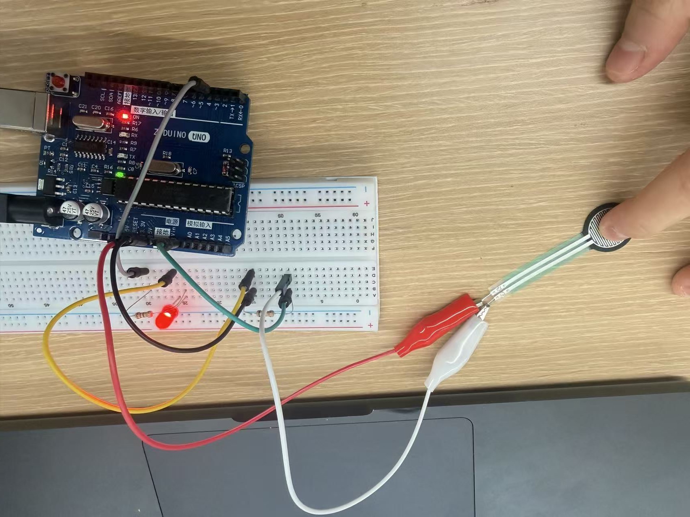
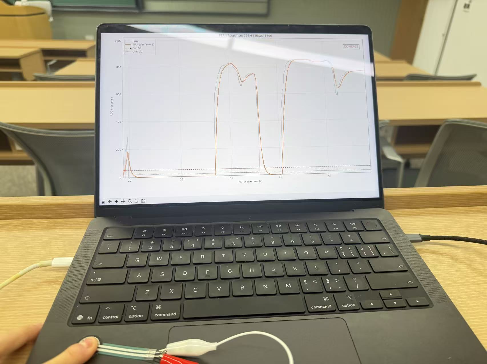
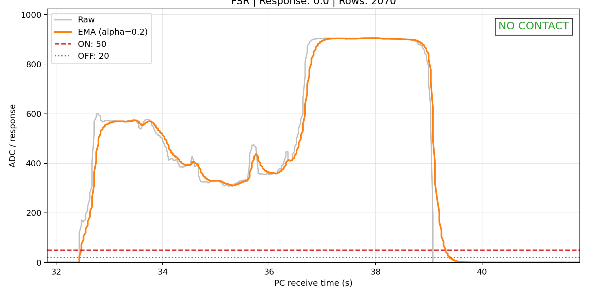
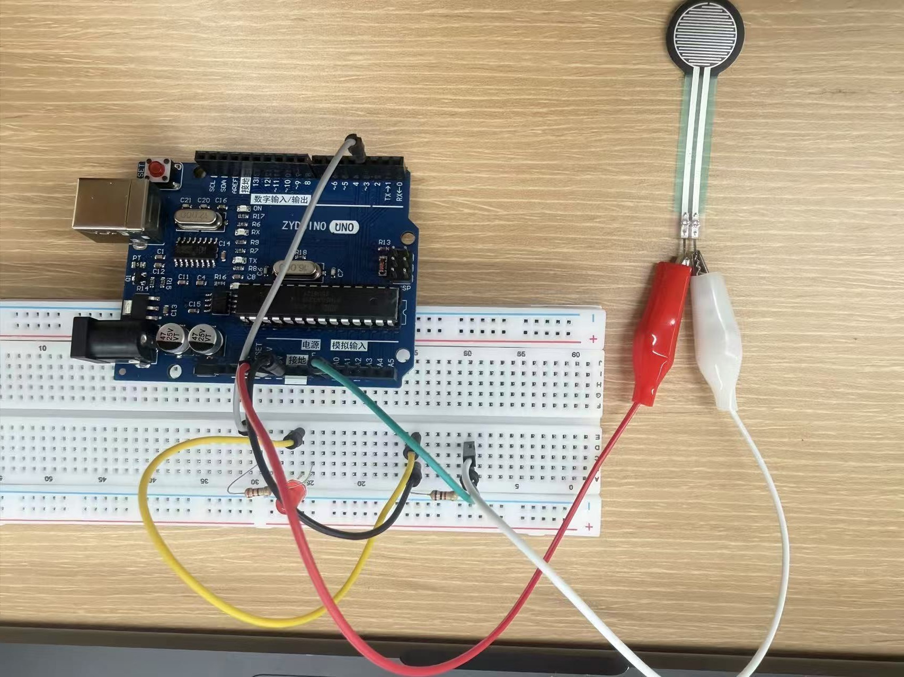
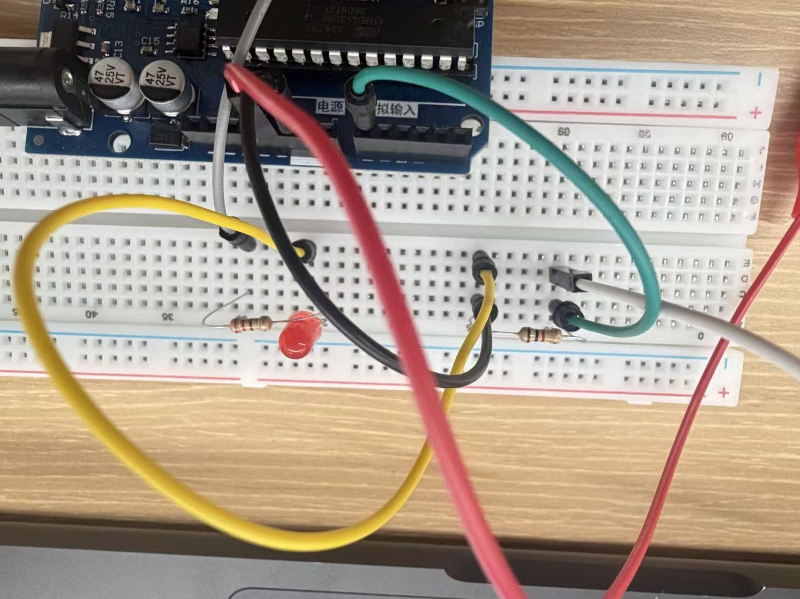
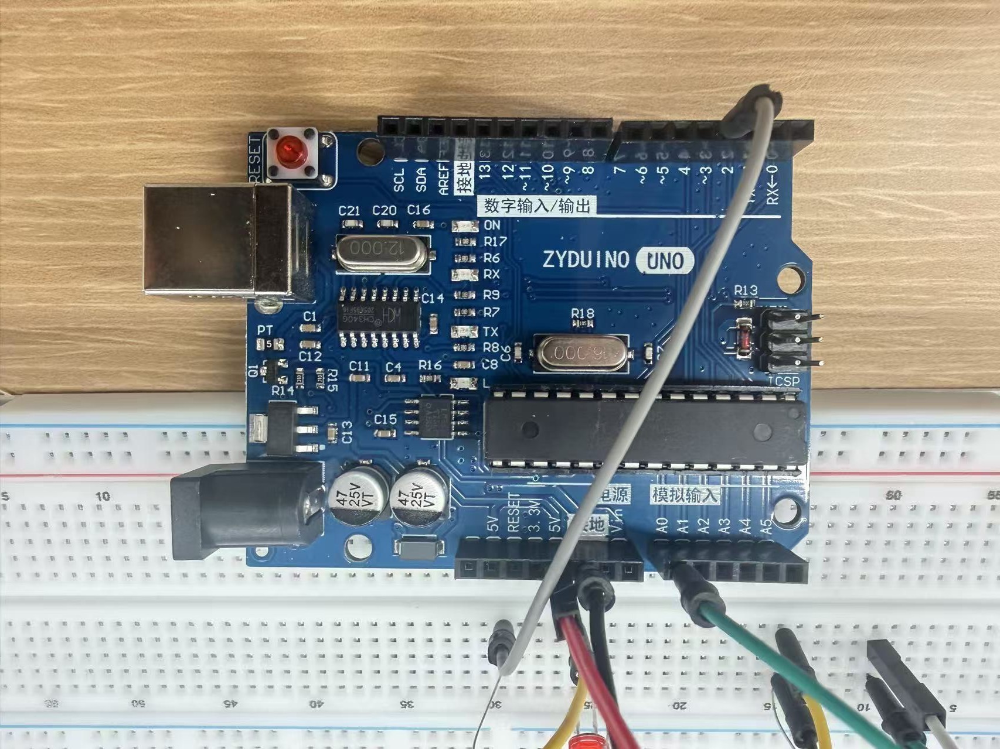

# FSR Pressure Sensing and LED Feedback Demo

基于 Arduino UNO、FSR402B 和 Python 的单点按压响应采集与 LED 反馈入门实验。

手指按压 FSR，Arduino 读取分压电压，经 EMA 平滑和滞回接触判断后控制 LED 的 PWM 亮度；Python 同时显示原始值与平滑响应，并保存 CSV 数据。

**当前已实际验证压力感知、实时曲线、数据记录及 LED 反馈。振动马达反馈尚未完成。** 这是学习项目，未进行力值标定，也不是完整 FlexiTac 复现。

## 展示



https://github.com/user-attachments/assets/bb58d39a-5cef-4ef7-9eaf-dc8895689e1e





## 硬件

- Arduino UNO R3 兼容板（本次使用 ZYDUINO UNO / ATmega328P）。
- 包装标为 FSR402B 的两端式薄膜力敏电阻。
- 1 kΩ 固定电阻，用于 FSR 分压。
- 红色 LED 与 220 Ω 串联限流电阻。
- 面包板、杜邦线、鳄鱼夹线、USB 数据线。

## 电路连接

断开 USB 后接线，检查后再通电。电阻值由色环识别，未使用万用表复核。

```text
5V ── FSR ──┬── A0
            │
           1 kΩ
            │
           GND

D3 (~3) ── 220 Ω ── LED 阳极（长脚）
                    LED 阴极（短脚）── GND
```

面包板使用的目标孔位（同编号 A～E 相通）：

- FSR 分压电阻 A10—A15；Arduino GND 接 B15。
- A0 接 C10；FSR 信号端接 D10；FSR 另一端接 Arduino 5V。
- LED 长脚 A25，短脚 A26；220 Ω 电阻 B25—B30。
- D3 接 C30；B26 用跳线接 C15，连接已有 GND。

孔位来自搭建步骤和现场确认；照片中部分插孔被遮挡，重搭时应核对电气连接，而非仅按照片中的线条位置判断。







整体图包含 FSR 与夹子，局部图辅助展示元件与引脚位置。部分插孔仍被导线遮挡；D3 位置经搭建者现场确认。照片已按展示需要旋转，未改变电路内容。按压亮灯照片与电脑曲线照片为不同画面，动态过程见原始视频。

## 原理与参数

本接法通常按压越大，FSR 电阻越小，A0 电压越高。UNO 使用默认模拟参考设置，ADC 为 0～1023。

```text
V_A0 = V_supply × R_fixed / (R_FSR + R_fixed)
EMA_new = 0.2 × ADC + 0.8 × EMA_previous
response = max(0, EMA - baseline)
```

- 固定基线：0，来自本次不接触观察，不是自动校准。
- 接触进入：响应 >= 50；接触退出：响应 <= 20；中间保留原状态。
- 未接触时 PWM 为 0。接触时将响应 0～900 映射至 PWM 0～255，并限制上下界。
- Arduino 每轮末尾等待 20 ms，输出约 50 条/秒，不是精确定时采样。
- 串口：115200 baud，每行一个原始 ADC 整数。

Arduino 独立执行 LED 控制，关闭 Python 后仍能工作。Python 根据原始 ADC 另行计算 EMA 用于显示，两端参数需要保持一致。CSV 中的 contact 是 Python 计算的状态，不是 Arduino 状态的回传。

## 运行

### Arduino

1. 用 Arduino IDE 打开 `arduino/04_fsr_led_feedback/04_fsr_led_feedback.ino`。
2. 选择 Arduino UNO 和实际 USB 串口，上传程序。
3. 观察松手熄灭、按压时亮度随响应变化。

### Python（本次在 macOS 验证）

依赖：Python、pyserial、Matplotlib。请在准备运行程序的同一个 Python 环境安装依赖。

在解压后的项目根目录打开终端：

```bash
python3 -m pip install -r requirements.txt
python3 -m serial.tools.list_ports -v
```

根据输出修改 `python/fsr_live_record.py` 顶部的 `PORT`。本次使用 `/dev/cu.usbserial-310`，其他电脑或更换 USB 插孔后名称可能不同。

关闭 Arduino 串口监视器和串口绘图器，释放端口，然后运行：

```bash
python3 python/fsr_live_record.py
```

打开串口可能使 UNO 复位，程序等待约 2 秒后开始记录。关闭曲线窗口结束记录并释放串口。

新记录保存在 `python/records/`。CSV 包含整次接收到的有效数据；PNG 是结束时最后约 10 秒的曲线。

## 实测与调试

- 先试用 10 kΩ 分压电阻，手指轻按容易接近 ADC 上限；改用 1 kΩ 后更容易区分力度。
- 用户观察：不接触约 0，轻按约 200，用力约 900。按压位置、接触面积和手势均影响读数，这些不是可重复的标准力等级。
- 示例数据 `data/example_run.csv`：2070 条读数，末条接收时间约 41.83 s，原始 ADC 为 0～918；记录三次进入和三次退出接触。
- EMA 降低短峰幅度，但对快速按压与松手引入延迟。
- 更换 Mac USB 接口后端口名称由 110 变为 310，需要重新选择。
- 遇到 `Resource busy`，检查 Arduino IDE 或其他 Python 程序是否占用串口。

## 限制与后续

- 输出是相对电信号，未标定为力（N）或压强（Pa），响应并非线性。
- 时间戳来自电脑解析数据时的时钟；缓存数据可能批量到达，不适合据此直接测量传感器的精确响应时间。
- 不接触为 0 是本次观察结果，不能推广为所有环境下无噪声。
- LED 反馈未构成力的闭环调节，也尚未实现夹爪控制。
- 后续比较同一数据下不同 EMA 参数的平滑与延迟，再完成马达可靠焊接、供电核对及振动强度测试。

## 学习来源与实现说明

学习动机与触觉感知入门参考来自 [FlexiTac](https://flexitac.github.io/) 和其[学习资料](https://flexitac.github.io/learn/)。本项目使用商用 FSR、Arduino UNO 和 LED；这里的 EMA、阈值、参数与代码是本入门实验的简化实现，不代表官方 FlexiTac 的具体实现或性能。

项目代码与文档在 AI 辅助指导下完成，由搭建者实际接线、上传程序、运行与调试。后续改进应以可复核的实验数据为依据。
